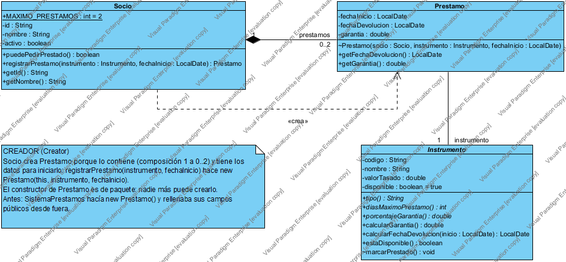
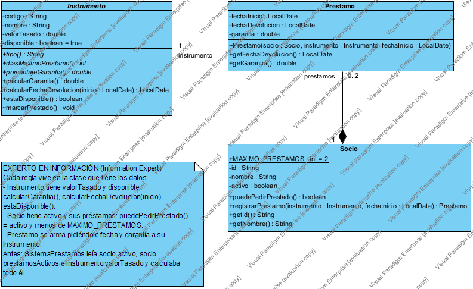
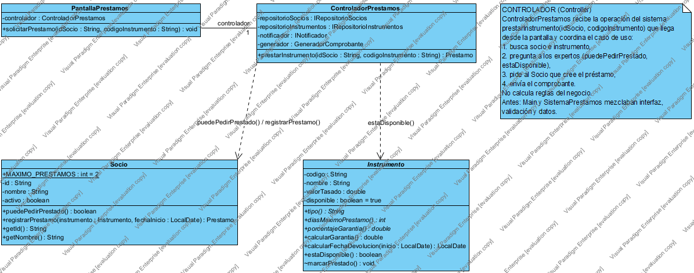
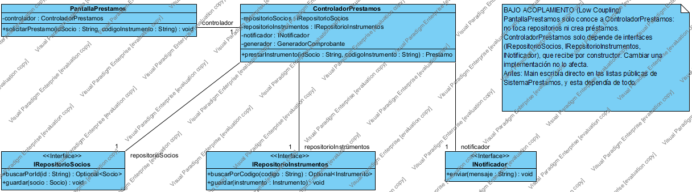
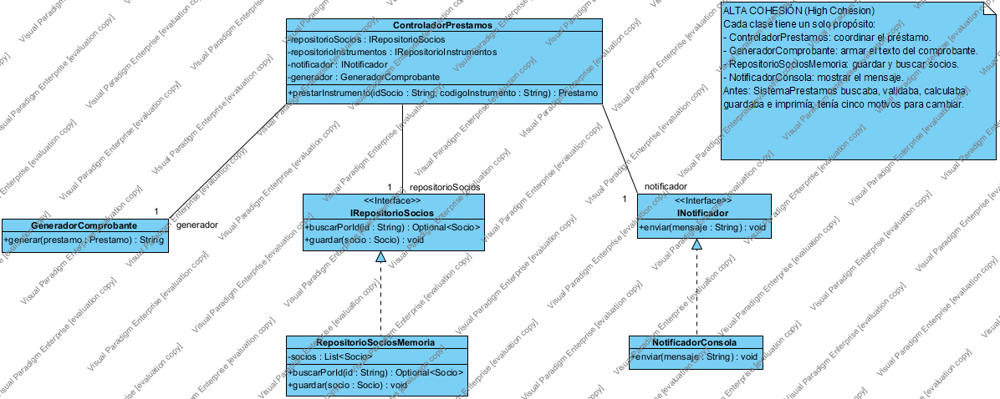
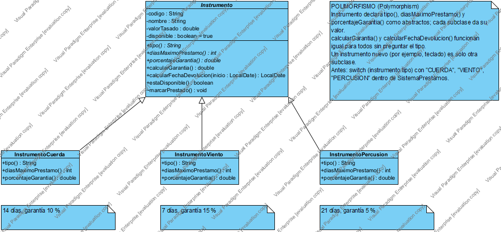
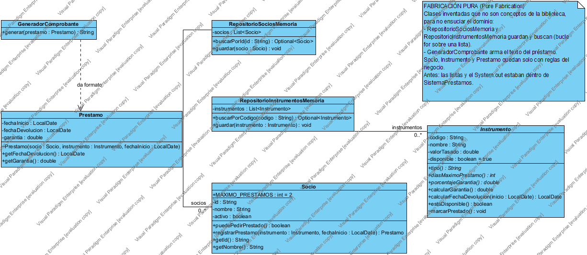
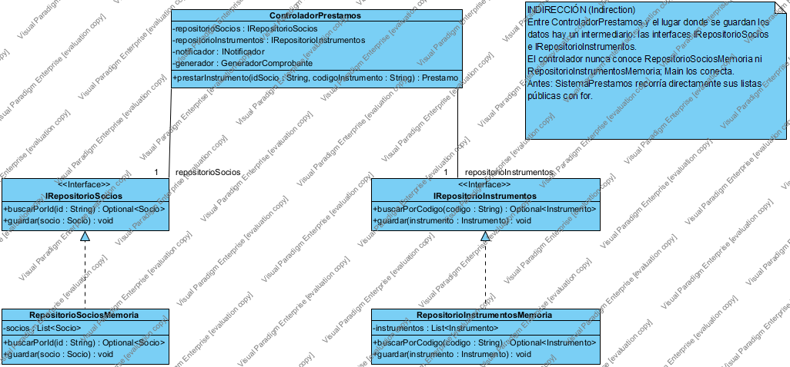
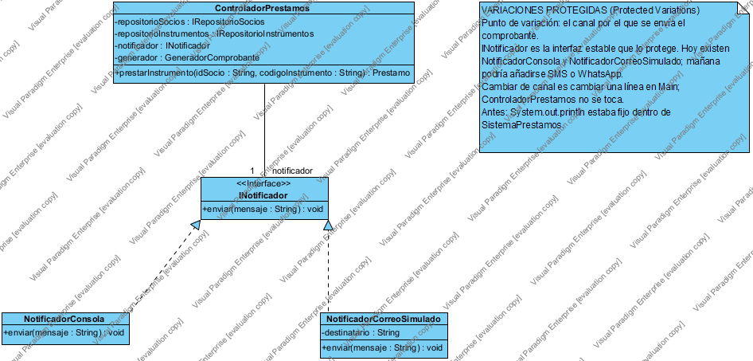

# Biblioteca de Instrumentos Musicales Raros — Patrones GRASP

Caso de uso: **"Prestar un instrumento musical raro"**, en una biblioteca que presta instrumentos antiguos y poco comunes (viola da gamba de 1720, serpentón barroco, tabla india).

## Caso de uso

**Actores**
- **Bibliotecario** (principal): registra el préstamo.
- **Socio**: pide el instrumento y recibe el comprobante.

**Flujo principal**
1. El bibliotecario indica el socio y el código del instrumento.
2. El sistema busca al socio y al instrumento.
3. Valida que el socio esté activo y tenga menos de 2 préstamos.
4. Valida que el instrumento esté disponible.
5. Calcula la fecha de devolución y la garantía según la familia:
   - Cuerda: 14 días, 10 %.
   - Viento: 7 días, 15 %.
   - Percusión: 21 días, 5 %.
6. Registra el préstamo y marca el instrumento como prestado.
7. Envía el comprobante al socio.

**Flujos alternos:** socio o instrumento inexistente, socio inactivo o con el máximo de préstamos, instrumento ya prestado.

## Código

Todo está en un solo archivo: [`BibliotecaMusical.java`](BibliotecaMusical.java).

- `Antes`: una "clase Dios" (`SistemaPrestamos`) busca, valida, calcula con `switch`, crea, guarda e imprime.
- `Despues`: la misma lógica refactorizada con los 9 patrones GRASP. Cada clase indica en un comentario qué patrón aplica.

```
javac -encoding UTF-8 BibliotecaMusical.java
java BibliotecaMusical
```

## Patrones GRASP aplicados

| # | Patrón | Dónde |
|---|---|---|
| 1 | Creador | `Socio.registrarPrestamo()` crea el `Prestamo` |
| 2 | Experto en Información | `Instrumento.calcularGarantia()`, `Socio.puedePedirPrestado()` |
| 3 | Controlador | `ControladorPrestamos.prestarInstrumento()` |
| 4 | Bajo Acoplamiento | `PantallaPrestamos` → controlador → solo interfaces |
| 5 | Alta Cohesión | Una responsabilidad por clase |
| 6 | Polimorfismo | `Instrumento` abstracta + `InstrumentoCuerda/Viento/Percusion` |
| 7 | Fabricación Pura | `RepositorioSociosMemoria`, `RepositorioInstrumentosMemoria`, `GeneradorComprobante` |
| 8 | Indirección | `IRepositorioSocios`, `IRepositorioInstrumentos` |
| 9 | Variaciones Protegidas | `INotificador` con `NotificadorConsola` y `NotificadorCorreoSimulado` |

## Diagramas (Visual Paradigm)

Cada patrón tiene su PNG en `docs/` y su proyecto editable en `docs/vpp/`. El proyecto completo con los 9 diagramas es `docs/BibliotecaInstrumentosRaros.vpp`.

### 1. Creador


### 2. Experto en Información


### 3. Controlador


### 4. Bajo Acoplamiento


### 5. Alta Cohesión


### 6. Polimorfismo


### 7. Fabricación Pura


### 8. Indirección


### 9. Variaciones Protegidas

